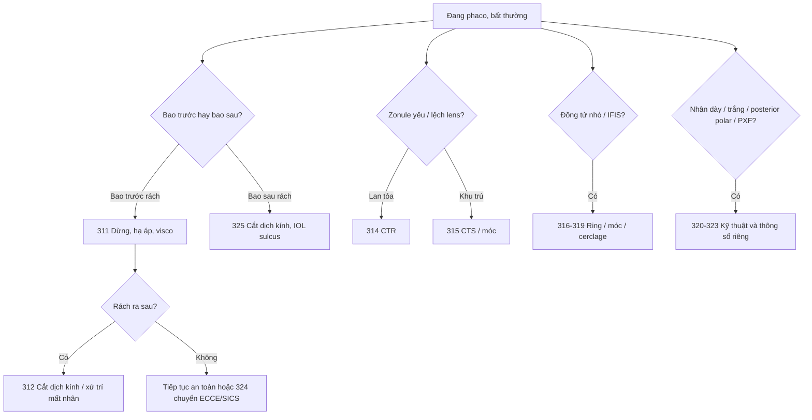

# Tổng quan Ca — Chặng 2: Biến chứng và ca khó (311–325)

> Mục tiêu: nhận ra sớm, dừng đúng lúc và chọn đường chuyển an toàn. Học sau chặng 1 (296–310); mỗi bài vẫn theo 6 mục, mục 4 có thêm thông số máy, điểm quyết định và biến chứng tại bước.

## Bản đồ bài học

| Nhóm | Bài | Việc cần nhớ |
|---|---|---|
| Bao và dịch kính | 311, 312, 325 | Rách bao trước lan sau; mất nhân; rách bao sau/IOL không vào bao |
| Zonule | 313, 314, 315 | Đánh giá yếu; CTR; CTS/móc zonule |
| Đồng tử và mống | 316, 317, 318, 319 | Đồng tử nhỏ; dính mống; IFIS; cerclage |
| Nhân và bao | 320, 321, 322, 323 | Đục dày; đục trắng; posterior polar; PXF |
| Chuyển đổi | 324 | Phaco → ECCE/SICS khi không còn an toàn |

## Cây quyết định

## Bốn quyết định sống còn

1. **Dừng trước khi cố thêm**: rách bao, mất nhân, surge lặp lại — chuyển kỹ thuật sớm thắng mọi cố gắng.
2. **Bảo vệ bao sau**: hạ vacuum, visco, không xoay nhân khi zonule yếu.
3. **Chọn IOL theo bao**: trong bao → sulcus → cố định củng mạc/AC; không cố đặt trong bao khi không đỡ.
4. **Đóng kín và hẹn đúng**: mọi ca biến chứng cần theo dõi nhãn áp, võng mạc, viêm.

## Học tiếp

- [Chặng 1 — phaco cơ bản](tong-quan-Ca-duc-thuy-tinh-the.md)
- [Chặng 3 — nâng cao](tong-quan-Ca-3-nang-cao.md)
- [Hậu phẫu và tối ưu](tong-quan-Ca-4-hau-phau-va-toi-uu.md)

## Bài liên quan

- [311 — Rách bao trước lan sau](311-rach-bao-truoc-lan-sau/technique.md)
- [312 — Mất nhân vào dịch kính](312-mat-nhan-dich-kinh/technique.md)
- [324 — Chuyển ECCE/SICS](324-chuyen-ecce-sics/technique.md)
- [325 — Rách bao sau/IOL không vào bao](325-rach-bao-sau-sot-nhan-iol/technique.md)
