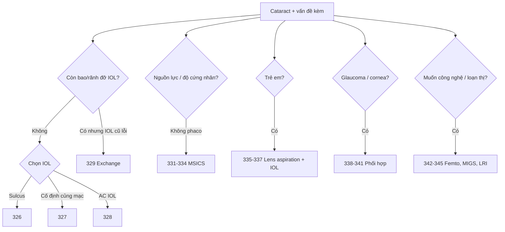

# Tổng quan Ca — Chặng 3: Nâng cao (326–345)

> Mục tiêu: làm chủ IOL phức tạp, SICS/MSICS, cataract trẻ em, phối hợp glaucoma/giác mạc và công nghệ femto/MIGS. Học sau chặng 2.

## Bản đồ bài học

| Nhóm | Bài | Việc cần nhớ |
|---|---|---|
| IOL phức tạp | 326, 327, 328, 329, 330 | Sulcus; cố định củng mạc; AC IOL; exchange; toric/premium |
| SICS/MSICS | 331, 332, 333, 334 | Aravind; Blumenthal; hypermature; chuyển phaco → MSICS |
| Cataract trẻ em | 335, 336, 337 | Lens aspiration; posterior capsulorhexis/optic capture; IOL/khúc xạ |
| Phối hợp | 338, 339, 340, 341 | Phacotrab; canaloplasty; Ahmed; phaco + giác mạc |
| Công nghệ | 342, 343, 344, 345 | Femto; femto + toric/trifocal; MIGS Kahook; LRI |

## Cây quyết định

## Nguyên tắc chung

- **Chọn IOL theo giải phẫu còn lại**, không theo thói quen: bao → sulcus → cố định củng mạc/AC.
- **MSICS không phải phaco kém hơn**: tunnel đúng, visco đúng, lấy nhân theo đường cong.
- **Trẻ em**: ưu tiên trục thông, kiểm soát đục bao sau, khúc xạ mục tiêu theo tăng trưởng.
- **Phối hợp**: xử lý glaucoma/giác mạc phải tính trước thứ tự và vị trí vết mổ.
- **Công nghệ**: femto/MIGS/LRI chỉ có lợi khi chọn bệnh nhân và kiểm tra trục/ thông số đúng.

## Học tiếp

- [Chặng 2 — biến chứng/ca khó](tong-quan-Ca-2-bien-chung-va-ca-kho.md)
- [Hậu phẫu và tối ưu](tong-quan-Ca-4-hau-phau-va-toi-uu.md)

## Bài liên quan

- [326 — IOL sulcus](326-iol-sulcus/technique.md)
- [331 — MSICS Aravind](331-msics-aravind/technique.md)
- [335 — Cataract trẻ em](335-cataract-tre-em-lens-aspiration/technique.md)
- [338 — Phacotrabeculectomy](338-phacotrabeculectomy/technique.md)
- [342 — Femto](342-femto-cataract-co-ban/technique.md)
