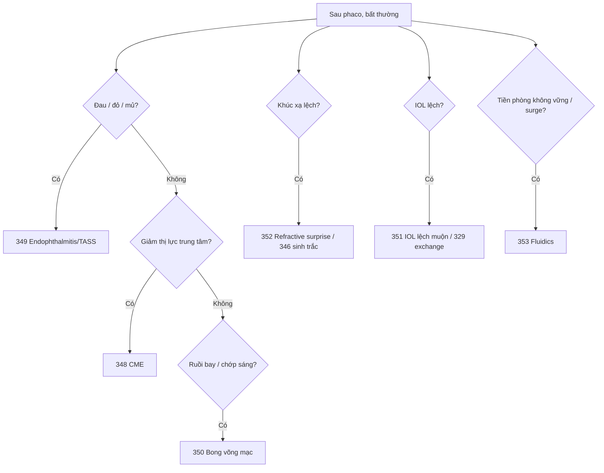

# Tổng quan Ca — Hậu phẫu và tối ưu (346–353)

> Mục tiêu: tối ưu trước mổ, nhận diện biến chứng muộn và xử lý khúc xạ/ fluidics. Đây là các bài bổ sung ngoài 3 chặng, dùng như checklist chất lượng.

## Bản đồ bài học

| Nhóm | Bài | Việc cần nhớ |
|---|---|---|
| Trước mổ | 346, 347 | Sinh trắc/chọn công suất IOL; quản lý loạn thị |
| Biến chứng muộn | 348, 349, 350 | CME; endophthalmitis/TASS; bong võng mạc |
| IOL và khúc xạ | 351, 352 | IOL lệch muộn; refractive surprise |
| Fluidics | 353 | Surge, tiền phòng, thông số |

## Cây quyết định

## Checklist trước mổ

1. Sinh trắc lặp lại, công thức phù hợp mắt dài/ngắn.
2. Loạn thị đều/không đều, trục đánh dấu khi ngồi.
3. Khúc xạ mục tiêu và kỳ vọng của bệnh nhân.

## Checklist hậu phẫu

1. 1 ngày: nhãn áp, giác mạc, IOL, đau.
2. 1 tuần: viêm, vết rạch, thị lực.
3. 1 tháng: khúc xạ, OCT nếu giảm thị lực, IOL.
4. Bất kỳ lúc nào: đau tăng, mủ, ruồi bay, chớp sáng → khám ngay.

## Học tiếp

- [Chặng 1](tong-quan-Ca-duc-thuy-tinh-the.md)
- [Chặng 2](tong-quan-Ca-2-bien-chung-va-ca-kho.md)
- [Chặng 3](tong-quan-Ca-3-nang-cao.md)

## Bài liên quan

- [346 — Sinh trắc IOL](346-sinh-trac-iol-power/technique.md)
- [348 — CME](348-cme-sau-phaco/technique.md)
- [349 — Endophthalmitis/TASS](349-endophthalmitis-tass/technique.md)
- [350 — Bong võng mạc](350-bong-vong-mac-sau-phaco/technique.md)
- [353 — Fluidics/surge](353-phaco-fluidics-surge/technique.md)
