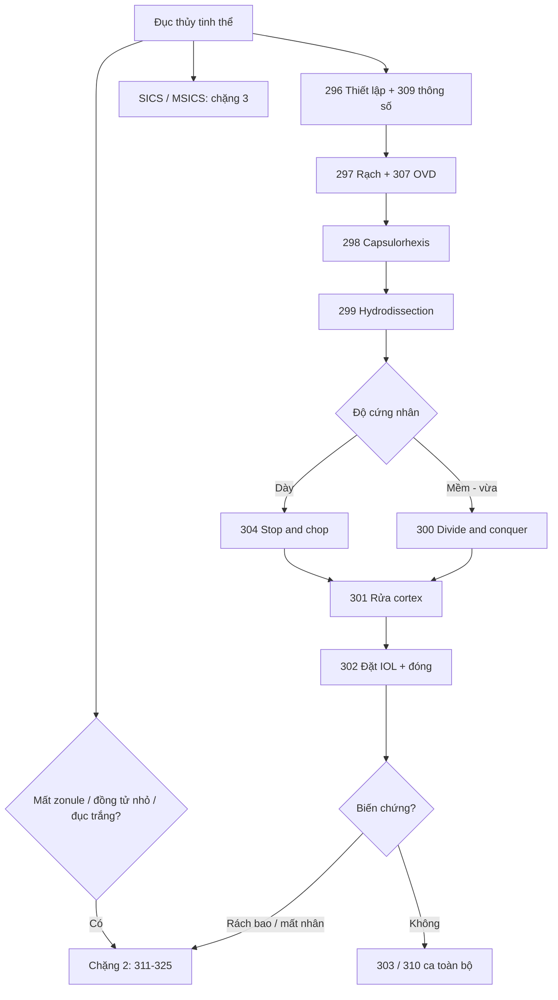

# Tổng quan nhóm Ca — Đục thủy tinh thể (bài 296–310, chặng 1)

> Mục tiêu: **làm được một ca phaco không biến chứng**. Học theo đúng trình tự mổ, không học bệnh lý. Nguồn: Cybersight (chuỗi 6 phần của Wyche Coleman + divide & conquer + stop & chop) và EyeRounds (Iowa OWL, ca toàn bộ).

## Trình tự 10 bước và bài tương ứng

| Bước | Việc | Bài |
|---|---|---|
| 0 | Thiết lập máy, thông số, tư thế | 296, 309 |
| 1 | Rạch phụ + rạch chính 3 mặt phẳng | 297, 308 |
| 2 | Viscoelastic, ổn định tiền phòng | 307 |
| 3 | Capsulorhexis 5–5,5mm | 298, 305 |
| 4 | Hydrodissection / hydrodelineation | 299 |
| 5 | Chia nhân (divide & conquer) | 300 |
| 6 | Nhũ hóa từng mảnh / stop & chop | 304 |
| 7 | Rửa cortex | 301 |
| 8 | Đặt IOL trong bao | 302 |
| 9 | Hút visco, hydration, kiểm tra | 302, 307 |
| 10 | Ca toàn bộ để ráp quy trình | 303, 310 |

## Ba kỹ thuật chia nhân — so sánh

| Kỹ thuật | Cách làm | Ưu | Nhược | Bài |
|---|---|---|---|---|
| Divide & conquer | Rãnh giữa → bẻ đôi → bẻ 4 | An toàn nhất cho người mới; luôn còn nửa nhân đỡ bao | Nhiều năng lượng hơn | 300 |
| Stop & chop | Rãnh → bẻ đôi → giữ chân không cao → chẻ 4–6 mảnh | Ít năng lượng, ít dịch, kiểm soát mảnh tốt | Cần phối hợp hai tay | 304 |
| Phaco chop | Chẻ trực tiếp không cần rãnh sâu | Nhanh, ít năng lượng nhất | Khó nhất, dễ rách bao | (chặng 2) |

## So sánh phaco — SICS — ECCE

| Tiêu chí | Phaco | SICS/MSICS | ECCE |
|---|---|---|---|
| Đường vào | 2,2–2,8mm | 6–8mm | 10–12mm |
| Lấy nhân | Nhũ hóa | Lấy nguyên nhân qua tunnel | Lấy nguyên nhân |
| Khâu | Thường không | Có thể khâu | Phải khâu |
| Trang thiết bị | Máy phaco | Tối thiểu | Tối thiểu |
| Chỉ định | Đa số | Nhân dày, nguồn lực hạn chế | Nhân rất dày, zonule yếu |
| Bài | 296–310 | chặng 3 | chặng 2 |

## Tiêu chí nghiệm thu một ca phaco cơ bản

1. Vết rạch kín nước, không rò, không loạn thị quá mức.
2. Capsulorhexis tròn, liên tục, 5–5,5mm, bao phủ mép IOL.
3. Nhân lấy sạch, bao sau nguyên vẹn.
4. Cortex sạch 360°, không sót.
5. IOL nằm trong bao, hai haptic mở đúng, trục đúng.
6. Không còn viscoelastic, nhãn áp sinh lý.
7. Giác mạc trong, không phù nặng.

## Bốn lỗi gây biến chứng nhiều nhất

1. **Rạch quá dài/quá trước** → rò, tiền phòng nông, surge. (308)
2. **Capsulorhexis rách nan hoa** → rách lan ra sau. (298, 306)
3. **Hydro sai mặt phẳng/không xoay** → căng zonule, rách bao. (299, 306)
4. **Đạp phaco khi chưa hút chắc mảnh cuối** → rách bao sau, mất nhân vào dịch kính. (300, 304)

## Học tiếp

- Chặng 2 (311–325): rách bao, mất nhân, zonule yếu, đồng tử nhỏ, đục dày/trắng.
- Chặng 3 (326–345): IOL phức tạp, SICS/MSICS, trẻ em, phối hợp glaucoma.
- Nguồn ngoài: [CataractCoach](https://cataractcoach.com/) (ca thực chiến), [Eyetube](https://eyetube.net/channels/cataract).

## Sơ đồ quyết định

