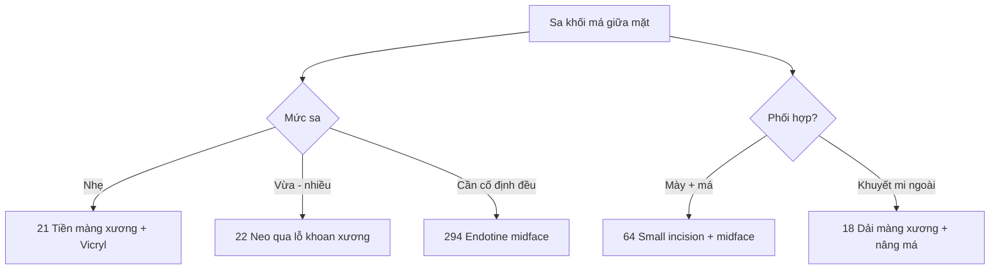

# Tổng quan nhóm D — Nâng má giữa mặt (bài 21–22, 294)

> Nhóm nhỏ (3 bài) nhưng là nền cho mọi phối hợp "má-mày-mi". Điểm chung: nâng **khối má** (malar pad) theo vector chéo lên-ngoài, không kéo da.

## Thứ tự học

1. **21 Nâng má tiền màng xương** — bóc trên màng xương, neo bằng Vicryl; bậc thấp nhất.
2. **22 Nâng má qua lỗ khoan xương** — neo xuyên xương, bền nhất.
3. **294 Endotine midface B** — dụng cụ cố định sinh học, phân bố lực đều.

## Cây quyết định

- Sa má nhẹ, cần nâng vừa → **21**.
- Cần neo bền, má sa nhiều → **22** (lỗ khoan).
- Muốn cố định đều, ít chỉ khâu, có dụng cụ → **294**.
- Phối hợp với mày/mi → **64** (small incision + midface) hoặc **18** (dải màng xương + nâng má).

## Bảng so sánh nhanh

| Bài | Mặt phẳng | Cách neo | Điểm sống còn |
|---|---|---|---|
| 21 | Tiền màng xương | Vicryl vào màng xương | Đúng vector chéo lên-ngoài |
| 22 | Dưới màng xương | Chỉ qua lỗ khoan | Tránh nhánh VII, đúng lỗ |
| 294 | Dưới/tiền màng xương | Ngạnh Endotine | Đối xứng hai bên |

## Lỗi chung

- Bóc nông chỉ kéo da → không nâng được khối má.
- Vector sai (thẳng lên hoặc ra ngoài) → bất đối xứng, hở mi.
- Không kiểm tra đối xứng khi bệnh nhân ngồi → đóng rồi mới thấy lệch.

## Sơ đồ quyết định

