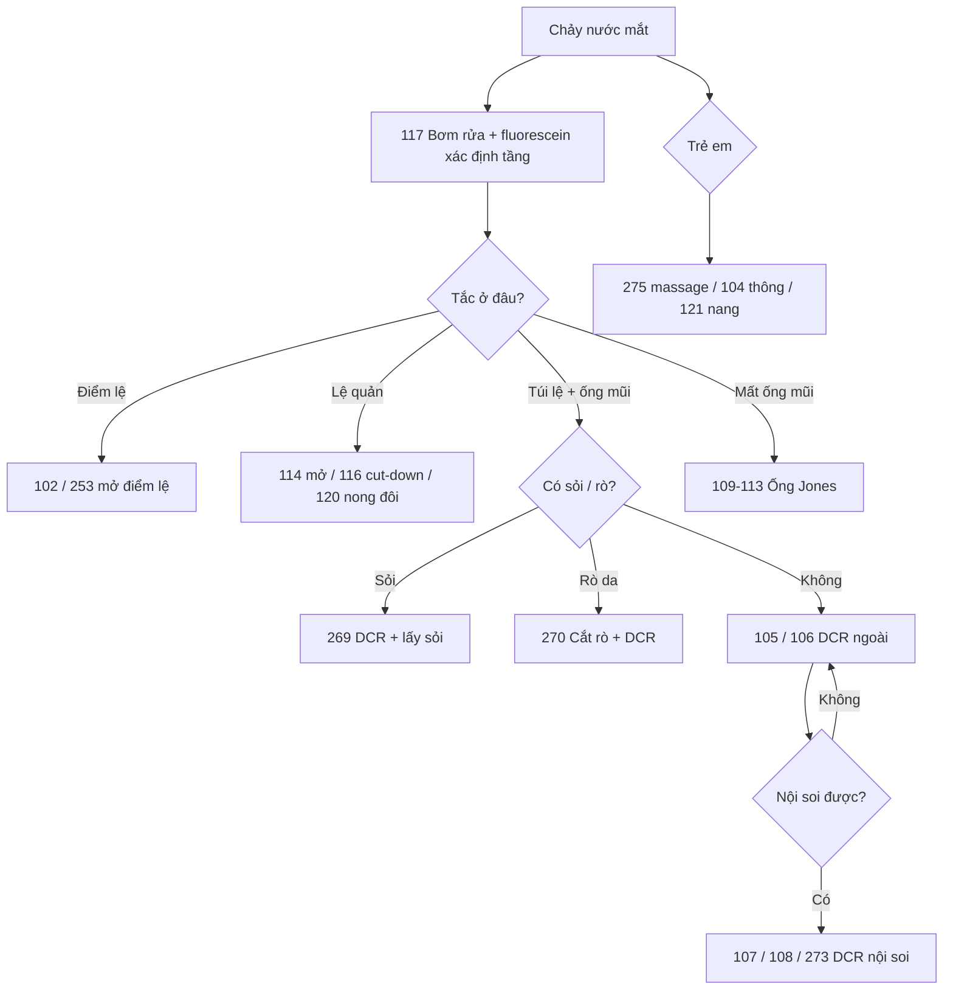

# Tổng quan nhóm L — Lệ đạo (bài 102–125, 267–275)

> Học bơm rửa phân tầng trước mọi mổ (bài 117): trào ngược ở đâu là tắc ở đó. Quy tắc vàng: đúng tầng-đúng thuật.

## Thứ tự học

### Chẩn đoán tầng tắc (117, 275)
1. **117 Bơm rửa fluorescein** — đọc trào ngược xác định tầng.
2. **275 Tắc lệ trẻ em** — khung: đa số tự thông, massage-trước thông-sau.

### Điểm lệ (102–103, 253–254, nhóm M)
3. **102 Mở 2 nhát + stent / 253 So 2 vs 3 nhát** — hẹp điểm lệ.
4. **103 Đốt bít / 254 Khâu bít thử** — khô mắt giữ nước mắt.

### Lệ quản (114–116, 120, 122, 125, 267, 274)
5. **267 Viêm lệ quản** — nặn-thông trước.
6. **114 Mở lệ quản** — sỏi-mủ không đỡ.
7. **122 Nút lệ sót** — phân biệt sỏi-nút.
8. **116 Mở cứu vãn** — nong hai chiều thất bại.
9. **120 Nong đôi / 125 Cứu stent** — nguy cơ cao và cứu vãn.
10. **115 Cắt lệ quản** — thang bít cao nhất.
11. **274 Đặt ống + tái tạo mi** — rách lệ quản kèm khuyết mi (nối nhóm T).

### Trẻ em (104, 121, 268)
12. **104 Thông + stent NLDO bẩm sinh** — màng tắc thường.
13. **121 Nang mũi** — thể nang đầu xa.
14. **268 Bất sản lệ đạo** — không phải tắc thường, đánh giá toàn hệ.

### Túi lệ-ống mũi (105–108, 269–273)
15. **105 DCR ngoài nền / 106 Biến thể / 272 Hai bên / 269 Lấy sỏi / 270 Rò da** — đường ngoài.
16. **107 Nội soi / 108 Khoan xương / 271 Bẻ cuốn mũi / 273 Qua đường mũi (Yang)** — đường trong-mũi.
17. So ba đường: ngoài (rõ, sẹo da) – nội soi (không sẹo, cần dụng cụ) – qua mũi (Yang).

### Ống Jones (109–113)
18. **109 Đặt nền → 110 Đổi ống → 111 Đường hẹp → 112 Nền sẹo → 113 Xoắn lưỡi liềm** — thang từ dễ tới khó.

### Tuyến lệ (123–124)
19. **123 Sinh thiết + đặt lại / 124 Viêm hạt sarcoid** — vừa chẩn đoán vừa giữ chức năng.

## Cây quyết định

- Chảy nước mắt: bơm rửa trước — trào ở điểm/lệ quản/túi/ống mũi thì mổ đúng tầng đó.
- Trẻ em: massage-theo dõi → thông (104) → nang thì xử trí nang (121) → bất sản thì đánh giá toàn hệ (268).
- Viêm túi lệ mạn + sỏi → DCR + lấy sỏi (269); rò da → xử trí gốc (270).
- DCR hỏng nhiều lần, mất ống mũi → Jones (109–113 theo thang).
- Khô mắt: khâu thử (254) → hợp thì đốt (103).

## Bảng so sánh nhanh

| Bài | Tầng | Nguyên tắc |
|---|---|---|
| 102/253 điểm lệ | Điểm | Mở thành sau, giữ bằng stent khi cần |
| 114–116 lệ quản | Quản | Thông → mở → cứu vãn → bít (thang) |
| 104/121 trẻ em | Ống mũi | Tự thông → thông → DCR |
| 105–108/269–273 túi-ống | Túi | Ngoài vs nội soi vs qua mũi |
| 109–113 Jones | Mất ống | Dẫn lưu trực tiếp, thang dễ-khó |
| 103/254 bít | Giữ nước | Thử tạm trước vĩnh viễn |

## Lỗi chung cả nhóm cần nhớ

- Sai tầng là sai tất cả (mổ túi khi tắc lệ quản).
- Stent rút sớm (<3 tháng lệ quản) → chít lại.
- DCR quên sỏi túi lệ → thất bại; Jones cho tắc còn mổ được → phung phí.
- Xì mũi mạnh sau DCR → chảy máu, bung cửa sổ xương.

## Sơ đồ quyết định

