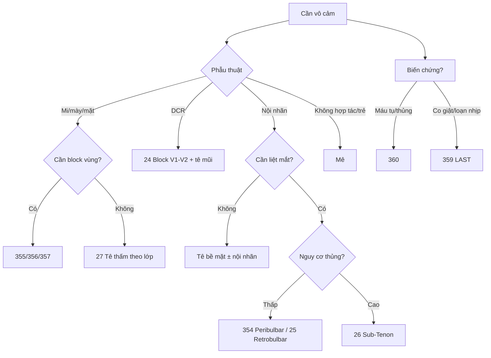

# Tổng quan nhóm N — Vô cảm vùng mi và ổ mắt (24–27, 224, 354–360)

> Mục tiêu: bác sĩ lâm sàng hiểu **lớp nào cần tê, kim đi đâu, dùng epinephrine khi nào, và xử trí biến chứng** — không chỉ nhớ tên kỹ thuật. Nhóm N gồm 5 bài nền cũ (24–27, 224) + 7 bài vùng/biến chứng mới (354–360).

## 1. Giải phẫu lớp mi — tê đúng lớp

Mi là cấu trúc nhiều lớp, mỗi lớp có cảm giác và độ di động khác nhau:

| Thứ tự | Lớp | Đặc điểm | Tê thấm nhắm tới |
|---|---|---|---|
| 1 | Da | Rất mỏng, nhiều thần kinh cảm giác | Trung bì (wheal) |
| 2 | Mô dưới da | Lỏng, ít mỡ ở mi | Dưới bì |
| 3 | Cơ vòng mi | Bơm lệ, nhắm mắt | Dưới cơ |
| 4 | Vách ổ mắt | Chắn mỡ, dính bờ xương | Dưới vách |
| 5 | Mỡ trước cân (mi trên)/mỡ ổ mắt (mi dưới) | Trượt, dễ đau khi kéo | Quanh mỡ |
| 6 | Cân cơ nâng/Müller (trên); cân mi dưới (dưới) | Nâng mi, co kéo | Trước cân |
| 7 | Kết mạc | Nhạy cảm, tê bề mặt | Giọt/gel, không kim |

**Điểm cần nhớ:** tê da không đủ cho bóc mỡ/cân; tê dưới cơ không đủ cho kết mạc; tê thấm không thay thế block thần kinh khi cần vô cảm rộng.

## 2. Tê thấm: kỹ thuật kim và liều

### Nguyên tắc
- **Kim 30G** cho mi (ít đau hơn 25–27G); dài ½ inch; bơm Luer lock.
- **Bevel up**, góc 15–30° với da; bơm chậm, vừa rút kim vừa bơm.
- **Hút thử** mỗi lần trước bơm; dừng nếu đau chói/da trắng bệch bất thường.
- **Wheal** 0,1–0,2 mL cho da; **0,2–0,5 mL** cho dưới da/dưới cơ; **0,2–0,5 mL** cho dưới vách.
- Giảm đau: làm ấm, buffer bicarbonate 1:10, tốc độ chậm; tránh jet injection.

### Liều và epinephrine
| Thuốc | Không epi | Có epi | Ghi chú |
|---|---|---|---|
| Lidocaine | 4,5–5 mg/kg (trần 300 mg) | 7 mg/kg (trần 500 mg) | 1% = 10 mg/mL; 2% = 20 mg/mL |
| Bupivacaine | 2,5 mg/kg | 3,5 mg/kg | Khởi phát chậm, kéo dài 6–8 giờ |
| Epinephrine | — | 1:100.000 = 10 µg/mL | Chờ ~7 phút ở mi để co mạch ổn định |

- **Dùng epi:** tê thấm mi/mặt, vạt da, blepharoplasty, cần cầm máu; chờ đủ 7 phút (analgesia ~2 phút).
- **Không/tránh epi:** block sau nhãn cầu/peribulbar thường quy; tiêm trong tiền phòng; vùng tận (đầu ngón, tai mũi); hẹp góc chưa điều trị; mạch vành không ổn định/nhồi máu mới; loạn nhịp nặng; tăng huyết áp/cường giáp/u tủy thượng thận chưa kiểm soát; đang dùng cocain; dị ứng sulfit; chẹn beta không chọn lọc (thận trọng).

## 3. Bản đồ block thần kinh

| Block | Thần kinh | Mốc | Thể tích | Bài |
|---|---|---|---|---|
| Supraorbital | V1 | Notch 1/3 trong bờ trên ổ mắt | 1 mL | 355 |
| Supratrochlear | V1 | Góc trong, trên gân góc trong | 0,5–1 mL | 355 |
| Lacrimal | V1 | Góc ngoài trên, sát xương | 0,5–1 mL | 355 |
| Infraorbital | V2 | Lỗ dưới ổ mắt: 5–8 mm dưới bờ, đường qua rìa giác mạc trong | 2 mL | 356 |
| Infratrochlear | V1 | Trên/dưới gân góc trong | 0,5–1 mL | 357 |
| Anterior ethmoidal | V1 | Thành trong ổ mắt, sát xương | 0,5–1 mL | 357 |
| Lacrimal fossa | V1–V2 | Màng xương mỏm trán xương hàm trên | 2–3 mL | 357 |
| Peribulbar | — | Ngoài phễu cơ, 2 mũi | 5–8 mL | 354 |
| Retrobulbar | — | Trong phễu cơ, 2 pop | 3–5 mL | 25/224 |
| Sub-Tenon | — | Khoang dưới Tenon, cách rìa 10 mm | 3–5 mL | 26 |
| Thần kinh mặt | VII | Lid block/O'Brien | 2–4 mL | 358 |

## 4. Chọn vô cảm theo phẫu thuật

| Phẫu thuật | Lựa chọn đầu tay | Thay thế |
|---|---|---|
| Mi/mày/mặt tỉnh | Tê thấm 27 ± block 355/356 | Block + tiền mê, mê |
| DCR ngoài | Block V1–V2 + thấm + tê mũi (24) | Mê |
| DCR nội soi | Mê (meta-analysis: thành công cao hơn) | Tê + an thần chọn lọc |
| Phaco/tán nhuyễn | Tê bề mặt ± nội nhãn | Sub-Tenon/peribulbar |
| Mổ cần liệt mắt | Peribulbar 354 hoặc retrobulbar 25 | Sub-Tenon 26, mê |
| Cận thị trục dài | Sub-Tenon 26 | Peribulbar, mê |
| Trẻ em/không hợp tác | Mê | — |

## 5. DCR: bốn vùng và ba block

1. **V2 — infraorbital:** 2 mL tại lỗ dưới ổ mắt.
2. **V1 — infratrochlear/anterior ethmoidal:** 1–2 mL góc trong, sát xương.
3. **Lacrimal fossa:** một điểm vào tới màng xương, 2–3 mL, chặn V1–V2.
4. **Niêm mạc mũi:** gạc tê ngách giữa 5–10 phút hoặc sphenopalatine.

Bằng chứng: lacrimal fossa block 66 ca cho analgesia tốt, ít song thị; DCR nội soi với mê có tỉ lệ thành công 90,8% so với tê + an thần 85,1% (meta-analysis 3282 ca) — tê là lựa chọn chọn lọc, không phải mặc định cho mọi ca.

## 6. Biến chứng và xử trí

| Biến chứng | Nhận diện | Xử trí |
|---|---|---|
| Máu tụ sau nhãn cầu | Đau, lồi mắt, cứng mi, RAPD, nhãn áp cao | Dừng mổ, đầu cao, hạ áp, canthotomy/cantholysis (360) |
| Thủng nhãn cầu | Đau, giảm thị lực, tiền phòng nông, thấy kim vào | Che chắn, kháng sinh, chuyển võng mạc, không ấn (360) |
| LAST | Tê quanh miệng, ù tai, co giật, loạn nhịp | Dừng bơm, ABC, lipid emulsion theo ASRA (359) |
| CRAO | Mất thị lực đột ngột, RAPD | Hạ nhãn áp, gọi cấp cứu, xử trí chèn ép |
| Nhiễm trùng | Đau tăng, mủ, sưng nóng đỏ | Cấy, kháng sinh, dẫn lưu |
| Song thị/ptosis | Hạn chế vận nhãn, sụp mi | Theo dõi, loại trừ tổn thương cơ/thần kinh |

## 7. Thứ tự học

1. **27** — lớp tê thấm, kim, epi, liều.
2. **355/356/357** — block mi trên/dưới/góc trong.
3. **24** — DCR phối hợp block.
4. **354/25/26/224** — peribulbar, retrobulbar, sub-Tenon.
5. **358** — akinesia thần kinh mặt.
6. **359/360** — LAST, máu tụ/thủng cầu.

## 8. Nguồn học sâu

- Ing EB et al. *Local anesthesia and anxiolytic techniques for oculoplastic surgery.* Clin Ophthalmol 2019. doi:10.2147/OPTH.S188790.
- Bajwa MS et al. *How long to wait after local infiltration anaesthesia: systematic review.* BJS Open 2023. doi:10.1093/bjsopen/zrad089.
- Pucchio A et al. *Anesthesia for ophthalmic surgery: an educational review.* Int Ophthalmol 2023. doi:10.1007/s10792-022-02564-3.
- Alhassan MB et al. *Peribulbar versus retrobulbar anaesthesia for cataract surgery.* Cochrane 2015. doi:10.1002/14651858.CD004083.pub3.
- Guay J, Sales K. *Sub-Tenon's anaesthesia versus topical anaesthesia for cataract surgery.* Cochrane 2015. doi:10.1002/14651858.CD006291.pub3.
- Vinciguerra A et al. *Role of anaesthesia in endoscopic and external DCR: meta-analysis of 3282 cases.* Eur J Ophthalmol 2022. doi:10.1177/11206721211035616.
- Schimek F, Fahle M. *Techniques of facial nerve block.* Br J Ophthalmol 1995. doi:10.1136/bjo.79.2.166.
- Smith MG et al. *Lacrimal fossa block for endoscopic DCR.* Clin Otolaryngol 2001. doi:10.1046/j.1365-2273.2001.00493.x.
- Neal JM et al. *ASRA practice advisory on LAST.* Reg Anesth Pain Med 2010. doi:10.1097/AAP.0b013e3181d22fcd; checklist 2020 doi:10.1136/rapm-2020-101986.
- Erickson BP, Garcia GA. *Evidence-based algorithm for acute retrobulbar haemorrhage.* Br J Oral Maxillofac Surg 2020. doi:10.1016/j.bjoms.2020.05.026.
- Sand JP et al. *Surgical anatomy of the eyelids.* Facial Plast Surg Clin North Am 2016. doi:10.1016/j.fsc.2015.12.001.

## 9. Sơ đồ quyết định

## 10. Checklist trước block

- [ ] Đúng chỉ định, đúng bệnh nhân, đồng thuận.
- [ ] Liều theo cân nặng, tổng liều ghi rõ.
- [ ] Monitor, đường truyền, lipid emulsion/airway sẵn sàng.
- [ ] Sát khuẩn, kim đúng cỡ, hút thử.
- [ ] Kiểm tra thị lực/đồng tử/nhãn áp sau block.
- [ ] Kế hoạch xử trí RBH/thủng/LAST.
