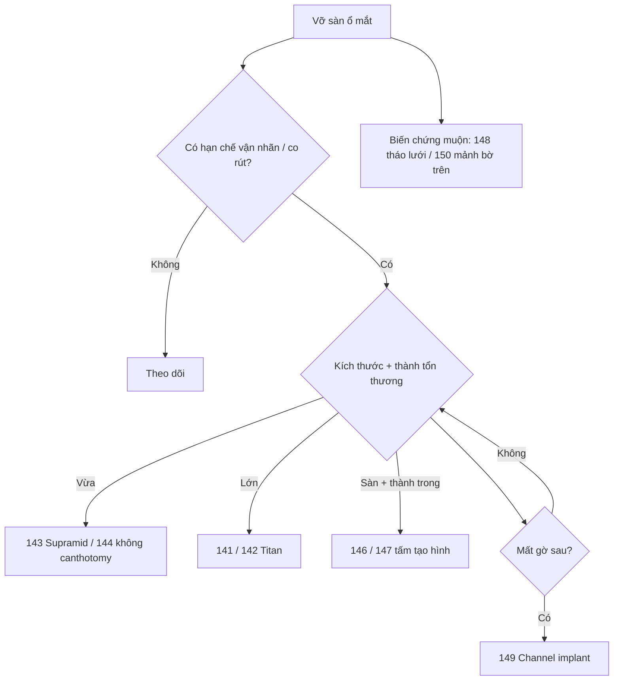

# Tổng quan nhóm O — Hốc mắt và vỡ sàn (bài 140–150)

> Nhóm này thiên về **vỡ sàn ổ mắt**: chỉ định mổ, chọn vật liệu, đường vào, và biến chứng. Đọc cùng giải phẫu hốc mắt + nhóm T (chấn thương) và nhóm C (tái tạo).

## Thứ tự học

### Nền và chỉ định (140–141)
1. **140 Vỡ sàn #1 (nền)** — kéo cưỡng bức 3 lần, bờ sau là mốc.
2. **141 Vỡ sàn #2 (vỡ lớn)** — titan 2 vít, kéo sau đặt tấm.

### Vật liệu (142–143, 147, 149)
3. **142 Porous polyethylene-titanium** — nâng cấp vật liệu.
4. **143 Supramid** — bản gọn vỡ vừa.
5. **147 Hình dạng tấm (cỏ 3 lá)** — cắt tấm theo khuyết.
6. **149 Channel implant** — mất gờ sau.

### Đường vào và kỹ thuật (144–146)
7. **144 Không canthotomy** — 2 silk thay canthotomy.
8. **145 Headlight camera** — đo bên lành, cắt môi trước.
9. **146 Sàn + thành trong** — nhìn 180°, hai đường nối.

### Biến chứng và dị vật (148, 150)
10. **148 Tháo lưới titan** — đau mạn, lấy trọn tránh sót.
11. **150 Lấy mảnh bờ trên** — sáp xương, mài nhẵn.

## Cây quyết định

- Vỡ sàn **nhỏ, không hạn chế vận nhãn** → theo dõi; có hạn chế/co rút → mổ.
- Vỡ **vừa** → 143 (Supramid) hoặc 142; vỡ **lớn** → 141/142.
- **Mất gờ sau** → 149; khuyết phức tạp → 147 (cắt tấm theo hình).
- Muốn **tránh canthotomy** → 144; cần nhìn rộng → 145/146.
- **Sàn + thành trong** → 146 (hai đường nối).
- **Biến chứng muộn**: lưới đau → 148; mảnh xương bờ trên → 150.

## Bảng so sánh nhanh

| Bài | Vật liệu/đường | Chỉ định | Điểm sống còn |
|---|---|---|---|
| 140/141 | Titan | Nền / vỡ lớn | Bờ sau làm mốc, kéo sau đặt |
| 142 | Porous PE + titan | Nâng cấp | Vít cố định, không di lệch |
| 143 | Supramid | Vỡ vừa | Đủ rộng che khuyết |
| 144 | Không canthotomy | Vỡ vừa, tránh sẹo | Bộc lộ đủ bằng silk |
| 145/146 | Headlight / hai đường | Nhìn rộng | Đo bên lành, đối xứng |
| 147/149 | Tấm cắt hình / channel | Khuyết phức tạp | Không để hở gờ sau |
| 148/150 | Tháo vật liệu | Biến chứng muộn | Lấy trọn, không sót |

## Lỗi chung cả nhóm cần nhớ

- Mổ khi chưa có hạn chế vận nhãn/co rút → mổ thừa.
- Tấm không tựa được gờ sau → tấm tụt vào xoang.
- Không đo/so bên lành → bất đối xứng.
- Bỏ sót mảnh xương/dị vật → đau mạn, nhiễm trùng.

## Sơ đồ quyết định

