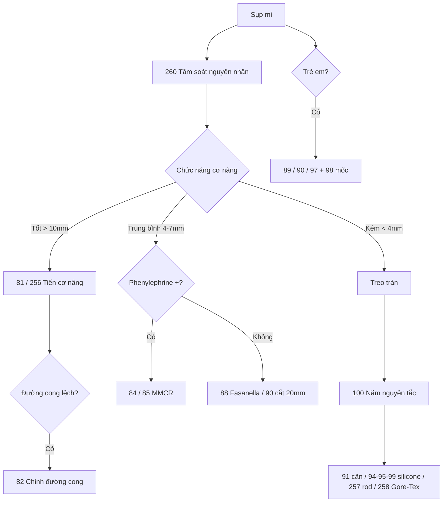

# Tổng quan nhóm P — Sụp mi (bài 81–101, 256–260)

> Hai nguồn: EyeRounds (21 video Allen: 81–101) + YouTube/Cybersight (256 Caesar, 257–260). Đọc giải phẫu mi trên + test phenylephrine trước nhóm này.

## Thứ tự học

### Tầm soát và khung chọn (260, 259)
1. **260 Tầm soát sụp mi** — khi nào tìm bệnh nền, khi nào mổ được.
2. **259 Lựa chọn bẩm sinh/mắc phải** — chức năng cơ nâng quyết định thuật.

### Tiến cơ nâng đường trước (81–83, 89–90, 256)
3. **81 Tiến cơ nâng người lớn** — bài nền: cắt bám cân khâu lại cao hơn.
4. **82 Chỉnh đường cong** — đỉnh lệch thì chuyển kim.
5. **83 Hốc sâu tuổi già** — mất mốc mỡ trước cân.
6. **256 Cắt ngắn Caesar (YouTube)** — cùng họ 81, so hai tay mổ.
7. **89 Tiến trẻ em** — vách dày, liều định trước, không căn ngồi.
8. **90 Bẩm sinh 20mm** — cắt bỏ đoạn dài cho cơ yếu vừa.

### Đường sau: MMCR và Fasanella (84–88, 97)
9. **84 MMCR nền** — tỷ lệ đánh dấu nửa-tổng gấp đôi.
10. **85 MMCR chuẩn hóa** — compa + hướng khâu.
11. **86 Nút ra da / 87 Vùi nút** — hai cách xử trí nút.
12. **88 Fasanella** — cắt cả 3 lớp 1/3 giữa (nặng hơn MMCR).
13. **97 MMCR trẻ em** — ngưỡng chặt + liều tối thiểu 9mm.

### Treo trán (91–96, 99–101, 257–258)
14. **100 Năm nguyên tắc** — học trước mọi treo: cố định sụn, bảo tồn da, không cắt mỡ, sau vách, móc cân.
15. **91 Treo cân tự thân** — vàng khi phải lấy mô được.
16. **92 Supramid 2 bên trẻ em** — treo tạm chờ lớn.
17. **94 Silicone trẻ em / 95 Hai bên bẩm sinh / 99 Hai bên người lớn (căn ngồi)** — silicone điều chỉnh được.
18. **257 Thanh silicone rod** — rod cứng giữ nếp sắc hơn vòng.
19. **258 Gore-Tex** — bám chắc, sợ nhiễm trùng; thang vật liệu: cân > Gore-Tex > silicone > supramid.
20. **96 Cắt cơ nâng + treo (Marcus Gunn)** — triệt đồng vận hàm.
21. **93 Sửa treo cân / 101 Sửa treo silicone** — siết lại qua sẹo cũ.

### Mốc giải phẫu (98)
22. **98 Vách trẻ em** — hai bẫy: vách dày + mỡ thâm nhiễm cân bẩm sinh.

## Cây quyết định

- Sụp mới mắc + dấu thần kinh (dao động, đồng tử, song thị) → **260 tầm soát trước, cấm mổ vội**.
- Chức năng cơ nâng tốt + sụp tuổi già → **81** (cong lệch thêm 82, hốc sâu thêm 83); muốn so tay mổ khác → **256**.
- Sụp nhẹ đáp ứng phenylephrine → **84/85 MMCR** (nút cộm: 86 ra da hoặc 87 vùi); nặng hơn một chút → **88 Fasanella**.
- Trẻ em: vách dày + nhược thị → **89/90** (đọc 98 trước); cơ quá kém → treo (**92 tạm**, **94/95** lâu dài).
- Cơ liệt (Marcus Gunn đã triệt, III mạn) → treo trán: cân tự thân **91**, silicone **94/95/99**, rod **257**, Gore-Tex **258** theo thang vật liệu.
- Tụt treo cũ → **93** (cân) / **101** (silicone): siết lại, cấm Vicryl sâu.
- BPES (sụp + góc trong) → treo **92** + góc trong **255** (nhóm M).

## Bảng so sánh nhanh

| Bài | Cơ chế | Khi chọn | Điểm sống còn |
|---|---|---|---|
| 81/256 tiến đường trước | Khâu cân cao hơn | Cơ nâng còn tốt | Căn ngồi (người lớn tỉnh) |
| 84–87 MMCR | Cắt ngắn Muller-kết mạc | Nhẹ + phenylephrine (+) | Tỷ lệ nửa-tổng gấp đôi; xử trí nút |
| 88 Fasanella | Cắt 3 lớp giữa | Hơn MMCR một bậc | Không cho sụp nặng |
| 91 cân / 94/95/99 silicone / 257 rod / 258 Gore-Tex / 92 supramid | Treo lên trán | Cơ liệt-kém | Thang vật liệu + 5 nguyên tắc (100) |
| 96 triệt + treo | Xóa đồng vận | Marcus Gunn | Cắt ngang sau nhất |
| 93/101 sửa treo | Siết lại | Tụt cũ | Qua sẹo cũ, cấm Vicryl sâu |

## Lỗi chung cả nhóm cần nhớ

- Mổ sụp nhược cơ/Horner/III mới mà không tầm soát → mổ sai bệnh.
- Quá tay ngay trên bàn → hở mi + trợt giác mạc (thà thiếu một chút, sẹo co còn nâng thêm).
- Quên Bell/khô mắt → trợt giác mạc sau mổ; quên Hering → lộ sụp bên kia.
- Treo trán: cắt mỡ trước cân, cố định sai (không vào sụn), đường luồn trước vách → nếp xấu + hở mi.

## Sơ đồ quyết định

