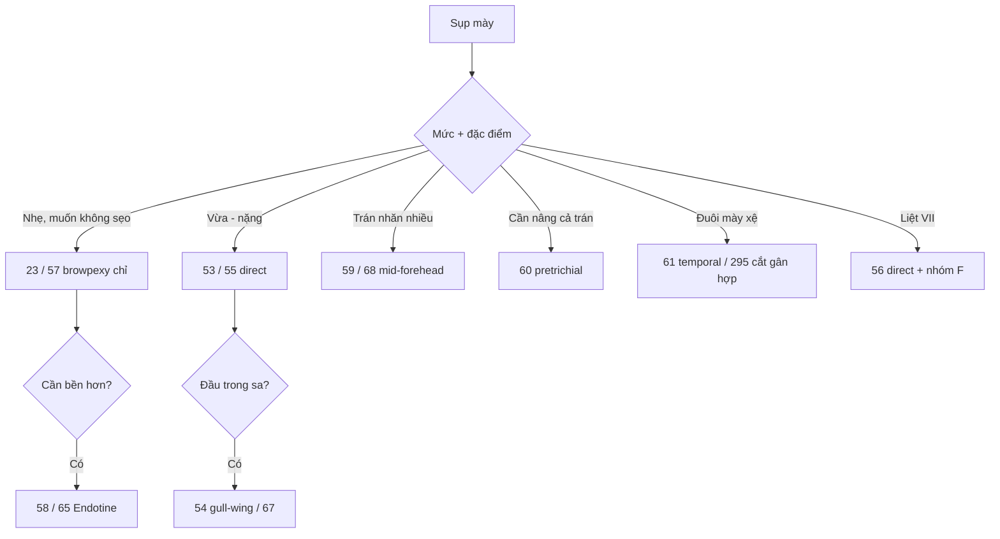

# Tổng quan nhóm W — Mày và trán (bài 23, 53–69, 295)

> Nhóm lớn thứ hai. Câu hỏi đầu tiên luôn là: **nâng mày bằng đường nào** — trực tiếp (sẹo thấy), qua mi (không sẹo), hay qua trán/da đầu (kéo cả trán). Chọn theo mức sa, giới tính, tình trạng da, và yêu cầu thẩm mỹ.

## Thứ tự học

### Nền tảng (53–56, 66)
1. **53 Direct browplasty** — cắt da ngay trên mày, kết quả chắc nhất, sẹo thấy.
2. **55 Direct #2** — ba điểm nhấn kỹ thuật.
3. **54 Gull-wing** — nâng cả đầu trong.
4. **56 Liệt VII** — direct cho mày liệt.
5. **66 Chi tiết đường rạch da đầu** — kỹ năng nền cho mọi đường qua trán.

### Qua mi và treo (23, 57–58, 62–65, 67, 69, 295)
6. **23 Small incision browplasty** — bài gốc đường nhỏ.
7. **57 Browpexy chỉ** — không sẹo ngoài, mức nâng nhẹ.
8. **58 Endotine browpexy** — treo dưới màng xương.
9. **62 Nam giới** — ba khác biệt.
10. **63 + cắt cơ cau mày** — xử trí nếp nhăn glabella.
11. **65 Double fixation** — chống tụt ở mày nặng.
12. **67 Nâng đầu trong** — phần small incision hay bỏ sót.
13. **69 Headlight camera** — xem toàn quy trình.
14. **295 Cắt gân hợp** — giải phóng đuôi mày ngoài.

### Qua trán (59–61, 68)
15. **59 Mid-forehead** — hai đường rạch giấu trong nếp trán.
16. **68 Forehead wrinkles** — biến thể cho nam nhiều nhăn.
17. **60 Pretrichial** — đường chân tóc, nâng cả trán.
18. **61 Temporal scalp** — nâng thái dương.

### Phối hợp (64)
19. **64 Small incision + midface** — ba tầng: trán, mày, má.

## Cây quyết định

- Mày sa **nhẹ**, bệnh nhân trẻ, muốn không sẹo → **23/57**; cần bền hơn → **58/65**.
- Mày sa **vừa-nặng**, da trán tốt → **53/55** (direct) hoặc **59** (mid-forehead).
- **Đầu trong** sa riêng → **54/67**.
- **Đuôi mày** xệ do dây chằng thái dương → **295** (cắt gân hợp) ± 61.
- **Trán nhăn nhiều, nam** → **68**; cần nâng cả trán → **60**.
- **Liệt VII** → **56** (direct) + nhóm F (bảo vệ giác mạc trước).
- Sa **cả má** → **64** hoặc nhóm D.

## Bảng so sánh nhanh

| Bài | Đường | Sẹo | Mức nâng | Điểm sống còn |
|---|---|---|---|---|
| 53/55 | Trên mày | Thấy | Chắc, kiểm soát tốt | Cắt đối xứng, không cắt quá |
| 54 | Trên mày (gull-wing) | Thấy | Cả đầu trong | Đường cong cân |
| 23/57 | Qua mi | Không | Nhẹ | Cố định vào màng xương/sụn |
| 58/65 | Qua mi + Endotine | Không | Trung bình-khá | Chống tụt |
| 59/68 | Giữa trán | Giấu trong nếp | Khá | Chừa cuống, không cắt thần kinh |
| 60 | Chân tóc | Giấu | Mạnh (cả trán) | Bảo tồn nang tóc |
| 61 | Thái dương | Giấu | Đuôi mày | Tránh nhánh VII thái dương |
| 295 | Thái dương | Nhỏ | Đuôi mày | Cắt đúng gân hợp |

## Lỗi chung cả nhóm cần nhớ

- Nâng mày quá cao → "mặt ngạc nhiên", hở mi khi ngủ.
- Không xử lý đầu trong/đuôi mày → mày cong sai hình.
- Qua mi mà không cố định vào màng xương → tụt sớm.
- Qua trán cắt sâu → tổn thương nhánh VII thái dương (liệt trán).

## Sơ đồ quyết định

